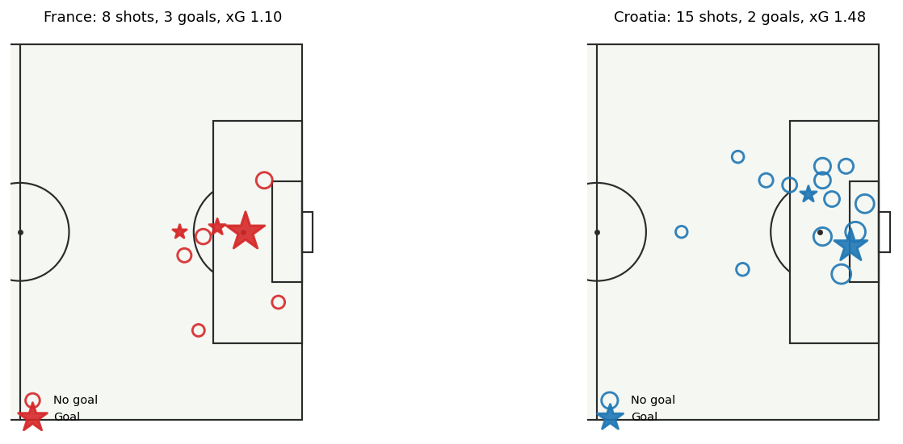
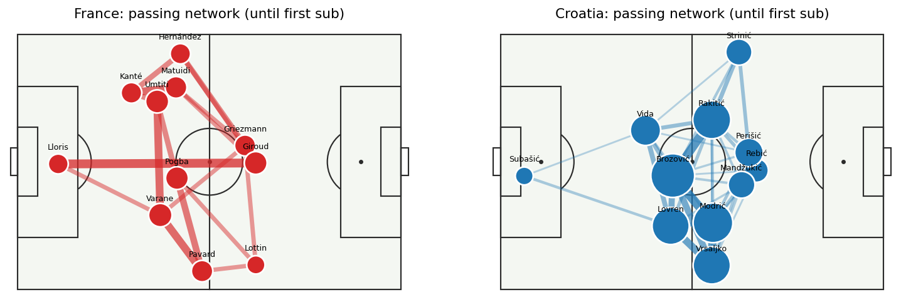

# StatsBomb Open Data Explorer

Shot maps, xG summaries, passing networks and PPDA (pressing) from
[StatsBomb free open data](https://github.com/statsbomb/open-data), with a one-command match report.
Example below: the 2018 World Cup final (match id `8658`).




| team    |   shots |   goals |    xg |   xg_per_shot |   passes |   pass_completion_% |   pass_share_% |   ppda |
|:--------|--------:|--------:|------:|--------------:|---------:|--------------------:|---------------:|-------:|
| Croatia |      15 |       2 | 1.48  |         0.099 |      554 |                80.9 |           65.5 |  10.5  |
| France  |       8 |       3 | 1.098 |         0.137 |      292 |                69.2 |           34.5 |  26.46 |

Note: France's 4 goals in the final include one Croatian **own goal**, which is not a shot, so the
table shows 3 France goals from shots. PPDA is lower for the team that presses harder; Croatia
(10.5) pressed far more than France (26.5) in this match.

## Features
- `load_events`, `load_matches`, `competitions`: cached wrappers around `statsbombpy`, with x/y columns split out
- `get_shots`, `plot_shot_map`, `xg_table`: shot extraction (shootouts excluded), xG-sized shot maps
- `passing_network`, `plot_passing_network`: completed-pass network until the team's first substitution
- `ppda`: passes allowed per defensive action in the opponent's 60% of the pitch
- `match_summary`: shots, goals, xG, passes, completion, pass share and PPDA per team

## Install
```
git clone https://github.com/<your-username>/statsbomb-open-data-explorer
cd statsbomb-open-data-explorer
pip install -e .
```

## Usage
```
python -m sbexplorer.report --list --competition 43 --season 3   # list World Cup 2018 matches
python -m sbexplorer.report --match-id 8658 --out docs           # build the report above
```
```python
from sbexplorer import load_events, get_shots, match_summary
ev = load_events(8658)
print(match_summary(ev))
```

## Method notes
- **Coordinates:** StatsBomb pitch is 120 x 80 (yards); every team attacks towards x = 120.
- **PPDA:** opponent passes with x < 72, divided by our tackles, interceptions and fouls with x >= 48.
  This is a common approximation; providers differ slightly in what counts as a defensive action.
- **Passing network:** node position is the average of where a player passes from and receives;
  node size is completed passes made plus received; edges are completed passes exchanged
  (min 3). Only the period before the team's first substitution is used.
- **Pass share** is the share of passes, a rough proxy for possession, not true possession time.

## Tests
```
pip install pytest
python -m pytest     # offline, uses a small synthetic event table
```

## Data and licence
Data: StatsBomb Open Data, used under StatsBomb's terms (attribution required; see their repo).
If you publish analysis from this data, credit StatsBomb. Code: MIT.

## Roadmap
- [x] Shots, xG, passing network, PPDA, report CLI
- [ ] Pressing maps from Pressure events
- [ ] Possession sequences and expected threat
- [ ] Multi-match team profiles
